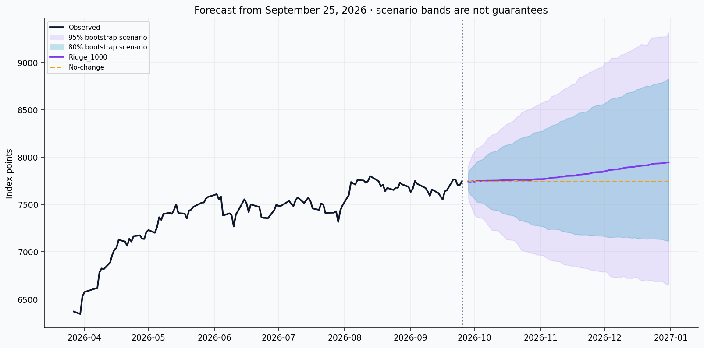

# S&P 500 Historical Data & 2026 ML Forecasts

**Author: Muhammad Ibrahim Shahrukh**

A beginner-friendly S&P 500 research project: clean daily OHLCV data, colorful exploratory analysis, leakage-aware machine-learning comparisons and forecasts for the remaining 2026 sessions.

**Repository name:** `sp500-historical-data-eda-ml-forecast`  
**Repository description:** S&P 500 daily data (1980–2026), interactive EDA, leakage-aware ML benchmarks and year-end forecasts with reproducible evaluation.

| Snapshot | Value |
|---|---|
| Instrument | S&P 500 price index, Yahoo symbol `^GSPC` |
| Observations | 11,779 daily rows |
| History | 1980-01-02 through 2026-09-25 |
| Future horizon | 67 scheduled sessions, 2026-09-28 through 2026-12-31 |
| Historical schema | date, ticker, open, high, low, close, volume |
| Price units | Index points, not dollars per share |
| Reproducible run | 14 code cells; 12 paired static/interactive chart panels |

## Start here

- Read [the dataset guide](DATASET_GUIDE.md) for copy-ready Kaggle metadata, data dictionaries, sources and exact transformations.
- Open [the executed notebook](notebooks/sp500_eda_ml_forecast_2026.ipynb) for the complete walkthrough.
- Read [the measured findings](reports/findings.md), [validation leaderboard](reports/model_leaderboard.csv) and [untouched test metrics](reports/test_metrics.csv).
- Open [the standalone research report](reports/sp500_research_report.html) in a browser for offline interactive plots.
- Review [the data audit](reports/data_quality.json) and [execution report](reports/execution_report.json).



## Results from the supplied snapshot

The validation winner is **Ridge regression with alpha 1,000**. Its mean six-origin log-RMSE is **4.552%**, narrowly ahead of XGBoost at **4.569%**; this small difference is not evidence of statistically significant superiority. The no-change validation score is **5.136%**.

On the untouched final test, Ridge records **101.02 points MAE**, **125.28 points RMSE** and **1.32% MAPE**, reducing RMSE by **29.97%** relative to no-change. Its December 31 central forecast is **7,945.51 index points**, versus the last observed close of **7,743.41**. The 80% bootstrap scenario range is **7,114.58–8,828.03**; the 95% range is **6,654.29–9,316.18**. These are uncertain research scenarios, not guaranteed or calibrated bounds.

These numbers describe the delivered executed version. After changing data, packages or methodology, rerun the experiment and refresh this summary from `reports/findings.md`.

## What is included

| Path | Purpose |
|---|---|
| `data/raw/sp500_yfinance_original.csv` | Original supplied export, unchanged |
| `data/processed/sp500_daily_clean.csv` | Clean historical Kaggle CSV |
| `data/processed/sp500_forecast_2026.csv` | Generated predictions, separate from observations |
| `notebooks/sp500_eda_ml_forecast_2026.ipynb` | Executed, self-contained analysis notebook |
| `scripts/clean_data.py` | Deterministic strict cleaning and audit |
| `scripts/build_notebook.py` | Rebuild the notebook source (clears existing outputs) |
| `scripts/execute_notebook.py` | Run all actual code cells and fail on errors |
| `scripts/package_reports.py` | Export the browser report and curate notebook outputs |
| `reports/` | Findings, metrics, predictions, split dates, visual panels and run audit |
| `DATASET_GUIDE.md` | Publishing text, dictionary and methodology |
| `COVER_IMAGE_PROMPT.md` | Copy-ready dataset cover prompt |
| `requirements.txt` | Compatible dependency ranges |
| `requirements-lock.txt` | Exact validated core package versions |
| `.gitignore` | Excludes secrets, caches and regenerable working outputs |

## Run locally

Python 3.12 was used for the supplied execution. A CPU is sufficient; GPU access is unnecessary.

```bash
python -m venv .venv
# Windows PowerShell:
.venv\Scripts\Activate.ps1
# macOS/Linux instead:
# source .venv/bin/activate
python -m pip install -r requirements.txt
python -m pip install -r requirements-lock.txt
python scripts/clean_data.py
python scripts/execute_notebook.py
python scripts/package_reports.py
```

For interactive work, run `jupyter lab` and open the notebook. Run all cells from a fresh kernel. The execution script sets the working directory to the project root; opening the notebook from its own directory is also supported by its CSV loader. Output files go to `sp500_outputs/` under the current working directory, or `/kaggle/working/sp500_outputs` on Kaggle.

If local kernel sockets are unavailable, `python scripts/execute_notebook.py --in-process` executes every notebook code cell in a fresh IPython process and captures its rich outputs without kernel sockets. The delivered notebook was validated through this route; it was not executed on the Kaggle service itself. Review `reports/execution_report.json` for the recorded mode and outcome.

The CSV is a fixed historical snapshot. Do not silently replace it with newer data: the notebook asserts its cutoff date, and the forecast calendar, splits and metadata should be updated together for a new version. The data audit records source and clean-file hashes.

## Run on Kaggle

1. Create a dataset from `data/processed/sp500_daily_clean.csv` after confirming the source-data publishing rights.
2. Import the `.ipynb` file as a notebook; attach the dataset using **Add Input**.
3. Run with a Python CPU session. No market-data download is needed.
4. The loader finds `sp500_daily_clean.csv` recursively below `/kaggle/input`, including nested `/datasets/...` layouts. If more than one distinct copy is attached, set `DATA_PATH` explicitly.
5. Run All and save a version with outputs. Dependency versions can affect results; the supplied snapshot run records exact versions. XGBoost is optional when absent, but a run without it has a different candidate set and must be described accordingly.

Every chart has a static PNG preview plus an interactive Plotly panel. Some viewers sanitize JavaScript or notebook HTML. PNG outputs remain visible; open exported standalone HTML panels or the browser report for offline interaction. HTML notebook styling may also be sanitized by the host. The notebook uses no external CSS or CDN.

## EDA and forecasting design

The 12 panels cover long-run price/drawdown, recent OHLC/volume, return tails/volatility, monthly heatmaps, annual and weekday patterns, autocorrelation, transformed-variable correlations, validation comparisons, fold stability, untouched test paths, horizon errors, feature importance and the final forecast. Several panels combine multiple graphs.

Forecasts model cumulative log returns at 1–67 sessions directly. Price-based features include lagged returns, rolling momentum/volatility, moving-average distances, intraday range, overnight return and trailing drawdown. The forecast origin is after the daily close. All feature windows look backward; all training target windows end by their origin.

Candidates are no-change, 252- and 1,260-session log drift, three Ridge regularization strengths, Random Forest, Extra Trees and XGBoost. The ML models use up to 2,520 eligible training origins. Six non-overlapping historical 67-session paths select the model by mean log-RMSE. The newest 67 observed sessions form an untouched test. The winner is locked before test evaluation; the final model is refit using available history.

Metrics include MAE/RMSE in points, MAPE, log-RMSE, R², endpoint direction and skill against no-change. Training-based Extra Trees importance is diagnostic, not causal evidence. No performance or notebook ranking is guaranteed.

Bands are 80%/95% quantile ranges from 5,000 centered moving-block-bootstrap shock paths using five-session blocks of the latest 1,260 returns. They are **scenario bands, not calibrated prediction intervals**. One test-path coverage diagnostic is reported; parameter uncertainty and future regime changes remain unmodeled.

## Provenance and responsible reuse

The user supplied the yfinance export of Yahoo Finance `^GSPC` data. Original retrieval time, yfinance version and adjustment arguments are unknown. The clean file removes two metadata rows, standardizes types/names/order and rounds OHLC to two decimals. No observed rows are removed or imputed. A zero-volume observation on 2023-05-24 remains visible and documented.

The index's level is not a share price. Price-only returns exclude dividends; volume is Yahoo's reported index field. Quotes were structurally checked, not independently reconciled against another provider. Full historical exchange-calendar completeness is unverified.

Sources: [Yahoo historical data](https://finance.yahoo.com/quote/%5EGSPC/history/), [yfinance documentation](https://ranaroussi.github.io/yfinance/), [S&P index overview](https://www.spglobal.com/spdji/en/indices/equity/sp-500/) and [NYSE calendar](https://www.nyse.com/trade/hours-calendars). Full citations appear in the guide and notebook.

**Data license:** redistribution rights are not established by this project. yfinance's open-source license does not license Yahoo data, and its documentation describes personal-use restrictions. Do not label the source data CC0 or assume that credit alone permits redistribution. No open-source/data license is assigned by this package; choose appropriate code and data licenses once you have the rights to do so.

## Publish the repository

Create an empty GitHub repository named `sp500-historical-data-eda-ml-forecast`, then run these from this project's root. Replace the username placeholder before the final commands. Review data rights before public distribution of raw and processed source data.

```bash
git init
git add .
git status
git commit -m "Add S&P 500 dataset, EDA and evaluated 2026 forecasts"
git branch -M main
git remote add origin https://github.com/YOUR_USERNAME/sp500-historical-data-eda-ml-forecast.git
git push -u origin main
```

The `.gitignore` retains curated data, reports and the executed notebook, and excludes local environments, credentials, caches and repeat-run working outputs. No credentials are included. This package prepares files; it does not publish to GitHub or Kaggle.

## Citation

Shahrukh, Muhammad Ibrahim (2026). *S&P 500 Historical Data & 2026 ML Forecasts*. User-supplied Yahoo Finance/yfinance `^GSPC` snapshot covering 1980-01-02–2026-09-25; curated 2026-09-27. Add the Kaggle dataset URL/version and repository URL after publication.
